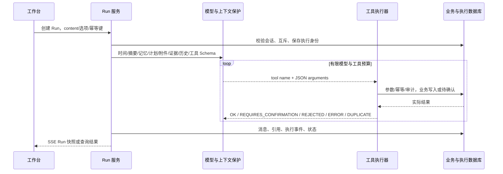

# Agent 执行链路、计划与恢复

本项目的 Agent 是**模型工具调用循环 + 持久执行状态 + 业务工具边界**。没有隐藏的多 Agent 自治集群，也没有默认开放任意 shell。Java 使用 Spring AI Advisor，Go 显式实现对等编排；共享工具见[完整目录](agent-tools.md)。

## 1. 一次用户请求如何执行



1. 前端选定会话、模型、思考档位、知识增强和附件；新版使用后台 Run API，旧 `/stream` 继续兼容。
2. 服务端检查会话可写、同会话执行冲突、模型并发/频率准入，并保存执行身份。不能同时对同会话发起互相覆盖的模型执行。
3. 系统提示按基础人设 → 滚动摘要 → 模块上下文（时间、长期记忆、确认/计划等）→ 附件 → 本轮知识证据拼装；会话历史与工具 Schema 也进入模型请求。
4. 模型决定返回正文、调用一个或多个已注册工具，或者提出澄清。模型不直接访问数据库。
5. 工具执行器检查参数和预算、记录审计，写工具使用稳定幂等身份，再调用业务服务。高风险工具只创建待确认事项。
6. 工具回执进入后续模型请求；结束时保存消息/引用，推进 Run 状态，用量记录和轮末摘要/记忆为独立后处理。

Java 装配入口为 [AiChatClientProvider](../backend/src/main/java/com/personalos/common/ai/AiChatClientProvider.java)，显式挂载 `MessageChatMemoryAdvisor` 与 `ToolCallingAdvisor`；Go 入口为 [chat/model.go](../backend-go/internal/business/chat/model.go) 和 [agent/tools.go](../backend-go/internal/business/agent/tools.go)。模型必须支持当前提供商的工具调用协议，普通文本补全接口不等同于工具模型。

### 两个完整示例

以下是合法执行路径示意，实际是否调用工具、调用顺序及正文由模型和当前状态决定，不是固定脚本。

| 用户目标 | 工具与状态流转 | 怎样判断完成 |
| --- | --- | --- |
| “查阅知识库的报销制度，创建一条准备报销材料的任务” | 创建 Run → `searchKnowledge` → 检查证据状态/片段 → `createTask` → 记录回执与回答；关键范围不明时可先 `askUser` | 检索结果只证明拿到了候选或证据；创建成功须有 `createTask` 的成功回执与任务 ID。资料无关、冲突或未核实时，不能把内容当作已确认制度 |
| “删除那条过期的报销任务” | `findTasks` 定位；多条匹配先澄清 → `deleteTask` 返回 `REQUIRES_CONFIRMATION` → Run 等待确认 → 用户在 UI 允许/拒绝 → 确认处理器执行或取消 → 结束等待 | 申请确认不代表已删除；以确认最终状态和业务结果为准。确认结束不会让原 Agent 再删一次 |

若过程中断，使用原 Run 的恢复入口核对已有回执；重新发送同一句话会形成新的执行身份。工具身份、人工确认和恢复保护的具体规则见后文。

## 2. 四类状态不要混用

| 对象 | 保存什么 | 不能推导出的结论 |
| --- | --- | --- |
| Run | 本次后台执行、事件、停止/恢复/等待 | `COMPLETED` 不表示所有外部系统事实都已核验 |
| 计划/步骤 | 会话目标、按序执行的工作项、结果摘要 | 标记步骤完成不替代业务工具回执 |
| 确认 | 一次高风险操作的人类决定、有效期、最终状态 | 模型创建确认不代表用户已同意 |
| operation_record | 工具幂等所有权、回执、审计与参数摘要 | 网络错误不代表远端未写入 |

### Run 状态

| 状态 | 含义与后续 |
| --- | --- |
| `RUNNING` | 后台执行中，可读取事件、停止或提交跟进 |
| `WAITING_USER` | `askUser` 已持久化，提交该问题答案后继续原 Run |
| `WAITING_CONFIRMATION` | 存在待确认操作，先允许或拒绝，再结束等待 |
| `INTERRUPTED` | 异常、预算、未完成计划或受控让出；满足条件才允许恢复 |
| `STOPPED` | 用户显式停止；保留进度，可按恢复条件继续 |
| `COMPLETED` | 本轮执行收尾；允许调度用户明确排队的下一条消息 |

工具失败通常通过回执、事件和 `INTERRUPTED` 表达，不能给 Run 虚构一个通用 `FAILED` 状态。知识索引任务另有 `FAILED`，那是不同状态机。

## 3. 计划与步骤

复杂任务可调用 `createPlan(goal, steps)`，最多 12 步。会话同一时刻最多一个 ACTIVE 计划；新计划/重规划会保留旧记录并标为 ABORTED。计划工具管理顺序，不能靠正文“第一步完成”变更状态。

```text
PENDING → RUNNING → DONE
             └──→ FAILED → RUNNING（显式重启）
PENDING/可跳过步骤 → SKIPPED
计划：ACTIVE → COMPLETED 或 ABORTED
```

开始/完成必须符合当前顺序；失败步骤先重启或跳过，不能直接标完成。完成需要已有工具结果或非空可核对 summary。当前实现允许 PENDING 的当前步骤在提供证据时直接 complete 并补记开始时间，因此“必须先调用 start”不是绝对契约。

成功工具结果可归集到正在执行的步骤，失败会留下原因和后续提示。`REQUIRES_CONFIRMATION` 也可能被记录为步骤产出，但只能说明申请已创建；实际写入仍以确认结果为准。计划提示默认启用，注入上限 1200 字符。

## 4. 人工确认与澄清

任务删除/优先级/截止时间调整、日程删除和默认的 MCP 变更工具返回 `REQUIRES_CONFIRMATION + confirmationId`。摘要、影响范围、参数与过期时间由服务端产生；UI 展示单次允许/拒绝。确认接口不注册给模型，模型不能批准自己。

确认过程校验状态、有效期、单次执行与处理器结果。确认完成后 UI 更新当前状态，`confirmations/finish` 只结束等待，不重新调用原 Agent 执行同一操作。用户取消/超时/执行失败都要保留，不能继续算作 PENDING。

`askUser` 用于缺少关键意图或参数：一个问题，最多四个选项，也可自由输入。问题与答案保存在数据库；答复恢复原 Run。**澄清答案不等于危险操作授权**。

## 5. 排队与执行中引导

- `QUEUE`：当前执行正常完成后依发送顺序处理，可编辑、取消或改为引导；编辑保留顺序和附件。
- `STEER`：新要求在下一安全检查点进入原任务，正在执行的工具先返回，随后调整剩余步骤；不会把已经成功的副作用倒回。
- 等待问题/确认、显式停止或异常中断期间保留队列；它不是“收到消息立即并行执行”。

重新发送原目标会创建新任务身份。想继续中断操作应使用 resume，不能用新消息模拟网络重试。

## 6. 持久恢复与不确定结果

Run 的事件与状态持久化；`GET .../runs/{id}/events?after=cursor` 发送 `event: run` 快照。断线只断开读取，后台 Run 继续；UI 根据序号追赶并去重。显式 stop 才取消执行。旧 POST `/stream` 与连接生命周期绑定，断开会取消上游，两种接口不能混用恢复语义。

恢复会重新读取计划、确认、工具回执与跟进，不重新写入同一用户消息。相同执行身份、工具名和规范化参数的成功写回执可复用；读工具使用新审计记录，避免回放过时查询。`startPlanStep` 的控制动作有特殊身份规则，以允许失败步骤重新进入 RUNNING。

恢复前必须检查：没有其他同会话执行、没有未回答问题、没有待处理确认、没有尚未核实的工具副作用。重启自动恢复只推进满足这些条件的任务；资源额度不足时延后调度。

工具可能已写远端、却未保存成功回执时，保留未知所有权并暂停自动重放。可使用“整理已有结果”（summarize）生成**无工具**摘要，原任务仍暂停；它不能解除未知副作用保护。恢复粒度是计划和工具，不支持从外部命令内部任意指令位置继续，也不提供跨系统 exactly-once 保证。

## 7. 回答可信性与可观察性

日程创建相关回复会检查本轮是否存在成功 `createCalendarEvent` 回执；常见虚报完成表述可触发最多一次纠正，仍失败则说明尚未创建。这是有范围的保护，不是对所有业务声明的形式化证明。

前端按 turnId 与消息区间关联工具轨迹，展示名称、耗时、状态及确认当前状态。审计 API 不返回原始参数，使用 `argumentsDigest` 关联。失败或预算中断可能保存带中断说明的部分回答，不能假定所有失败都只留用户消息。

追踪与预算见[执行可靠性](agent-reliability.md)，上下文/记忆见[专文](memory-and-context.md)，HTTP 端点见[API](api.md)。
