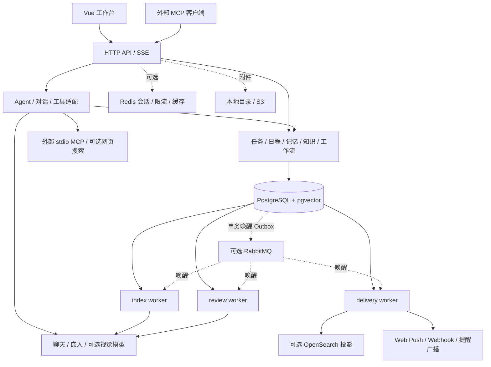

# 系统架构

本文描述当前代码结构。共享行为适用于 Java 主后端和 Go 候选后端；发布边界见[双版本说明](backend-parity.md)。历史阶段方案保留在 `specs/`，不能替代当前实现。

## 总体拓扑

系统是单用户的模块化应用。默认 `combined` 在一个进程提供 API 与后台工作；也可把 `api/index/review/delivery` 作为同一应用的独立角色运行，共享业务数据库。角色拆分不增加多租户或团队权限。

## 代码边界

| 职责 | Java | Go |
| --- | --- | --- |
| HTTP/生命周期装配 | `PersonalOsApplication`、Controller、配置 Bean | `cmd/personalos`、`internal/app` |
| 公共 AI/保护 | `common/ai`、`common/web` | `business/model`、`business/context`、`platform/modelgate`、`platform/http` |
| 对话与持久 Run | `chat` | `business/chat` |
| 工具/计划/交互 | `agent`、`common/ai/tool` | `business/agent`、`business/confirmation`、`business/idempotency` |
| 知识与 RAG | `knowledge` | `business/knowledge` |
| 业务模块 | `task/calendar/memory/workflow/maintenance/export` | `business` 下对应模块及 `dataimport/dataexport/exchange` |
| MCP | `mcp` | `business/mcp` |
| 数据访问 | JPA、JdbcTemplate、Flyway | 显式 SQL、pgx/事务、Flyway 历史只读校验 |

Java 根包是 `com.personalos`；Go 目录以 `backend-go/internal/` 为前缀。详细源码对照见[双版本说明](backend-parity.md#源码导航)。前端请求集中在 `frontend/src/api/`，store 和组件负责执行状态、引用、待确认卡片与重连。

## 三条核心链路

### Agent 执行

持久 Run 接收请求 → 会话互斥和模型准入 → 组装时间/摘要/记忆/计划/附件/证据 → 模型返回文本或 tool calls → 工具预算、参数校验、幂等与审计 → 业务服务执行或创建待确认 → 结果回给模型 → 保存消息、引用、事件与用量。

Run、计划、确认、工具操作记录是不同对象：运行结束不代表待确认操作已经执行，步骤失败也不会撤销之前成功的副作用。见[Agent 执行链路](agent-runtime.md)。

### 知识摄入与问答

上传/采集 → 解析文字 → 按标题/段落结构切块 → 嵌入 → PostgreSQL 写入 → 可选搜索投影与后台冲突审查。查询时先召回，再改写、多查询融合、重排、证据精审，最后决定回答、澄清或展示冲突。见[RAG 全流程](rag.md)。

异步索引在事务外完成解析和嵌入，在短事务中检查任务租约/文档写入所有权并提交索引。Java 旧同步上传仍采用分阶段写入与失败补偿，不能把所有入口都描述为同一原子事务。

### 提醒与投递

数据库周期扫描任务截止时间与重复日程，按唯一键物化提醒。页面 SSE 发送到点未读快照，HTTP 补查兜底；Web Push/Webhook 使用独立持久投递记录。RabbitMQ ACK 表示唤醒消息处理完成，不能当成索引成功或用户已读。见[提醒链路](reminder-stream-and-queue.md)。

## 数据与一致性

- PostgreSQL 保存业务实体、聊天历史/摘要/Run、确认、操作审计、知识片段/向量、后台任务和 Outbox；它是持久任务事实来源。
- `vector_store` 保存知识片段与 1024 维向量；长期记忆的向量属于独立的记忆数据。相似度不代表事实可信度。
- Redis 候选/嵌入缓存可按已实现策略降级；共享会话和共享限流的故障语义不同，不能统一视为可忽略。见[Redis 扩展](redis-extensions.md)。
- OpenSearch 是派生索引，RabbitMQ 是唤醒/广播通道，均不替代数据库任务状态。
- 附件使用本地目录或 S3；数据库备份、业务 JSON 导出和原始文件备份各有范围。
- SQL 唯一来源是 `backend/src/main/resources/db/migration/`，当前包含 V1–V49；固定 Go 迁移基线是 V1–V42，V43–V49 是之后追加的产品迁移。Go 不拥有 DDL 执行权。

业务写入经服务层/显式事务执行，HTTP DTO 与内部实体分离。耗时模型调用尽量移出写事务；跨进程工作用数据库时钟、租约、续租和 fencing 防止过期执行器提交。

## 信任边界

模型只能通过已注册工具执行副作用。删除/关键字段调整与 MCP 变更操作走确认；确认接口不注册为模型工具。资料、网页和远端工具文本是不可信数据，不能提供更高权限。

单用户认证不是多租户授权。外部模型、Brave、外部 reranker、MCP 子进程、Webhook 目的地与 S3 都形成独立的数据出口，需由部署者明确配置。更多说明见[安全策略](../SECURITY.md)和[MCP 指南](mcp.md)。

## 部署选择

Java 开发/整机/生产 Compose 位于根目录；Go 候选配置位于 `backend-go/deploy/`，使用独立项目和卷。角色职责与端口见[独立 Worker](distributed-workers.md)，启动和配置见[开发指南](development.md)，Go 发布残余项仍以迁移验收记录为准。
