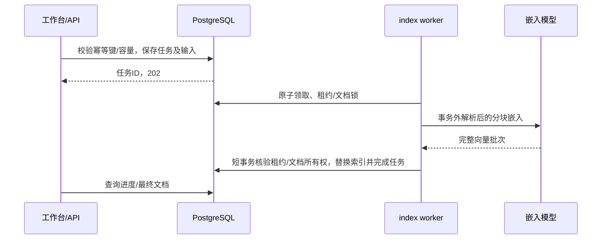

# 知识摄入、切块与索引

本文解释资料如何成为可检索片段。阅读前可先看[RAG 总览](rag.md)。Java/Go 的共享算法以当前实现为准，语言差异在文末明确列出。

## 1. 入口与解析

| 输入 | 处理方式 | 限制 |
| --- | --- | --- |
| `.md/.markdown/.txt` | 严格 UTF-8 解码，保留文本结构 | 无效编码拒绝，不猜编码 |
| `.pdf` | Java PDFBox；Go Poppler `pdfinfo/pdftotext` | 只读文本层；加密、损坏、超过 500 页或无可用文字时拒绝；不含扫描 PDF OCR |
| `.docx` | 按正文顺序提取段落与表格单元格 | 不支持旧 `.doc`；不能还原完整页面版式 |
| `.png/.jpg/.jpeg/.webp/.gif` | 视觉模型转录后进入同一文本链路 | 需要可读图的聊天模型；这是模型转录，不是确定性 OCR |
| 公开网页采集 | 抓取公开正文并直接排入索引任务，保留正文版本和哈希 | 公开网页有抓取边界；不执行网页指令，不绕过登录/私网限制 |

服务端校验文件名、扩展名、空文件和大小。默认 `AI_KNOWLEDGE_MAX_FILE_SIZE=5242880`，解析文本总长小于 `AI_KNOWLEDGE_MIN_CHUNK_SIZE_CHARS=350` 时拒收。因此一个合法的短文件也可能无法入库。

知识文件摄入和聊天附件是不同入口：聊天附件供当前对话使用，上传附件本身不自动建知识索引；知识采集需要显式提交。原始知识文件不作为可下载原件长期保留，任务输入字节只服务任务执行/清理周期；需要保存原件时自行备份。

## 2. 结构切块算法

当前不是固定 token 的 `TokenTextSplitter`，也没有使用“语义相似度聚类切块”。实际步骤如下：

1. **结构识别与标题分节**：先扫描受保护原文区间，再识别行首 `#` 到 `######` 的 Markdown 标题，维护六级标题路径。受保护内容中的 `#` 不当标题。没有标题的 PDF/DOCX 文本退化为一节。
2. **原子结构与段落累积**：围栏代码、缩进代码、Markdown 表格、连续多行制表符表格、列表（含嵌套项）、引用块和块级公式作为不可拆分的原子单元；普通文本按空行分段。短节直接成块，长节逐单元累积，超过目标长度前输出已有块。
3. **长段兜底**：仅超长普通段落按字符切。在目标位置向前约 30% 范围内优先寻找句末标点/换行，再找空白，最后硬切。断点避开完整行内代码与 Unicode 代理对；原子结构即使超过目标长度也整块保留。
4. **可选重叠**：同节拆出的相邻普通块可把前一块尾部接到下一块头部；默认 0。任一相邻块含受保护内容时跳过该处重叠，避免复制半段代码、表格或公式。它不是整个文档的滑动 token 窗口，也不在所有标题之间自动重叠。
5. **短块合并**：当前块不足最小字符数时，尝试并入前一块，保留前一块的标题路径；合并后正文不能超过目标长度的 1.5 倍。首块或不满足上限的短块仍可能保留。
6. **最后加标题前缀**：每个合并后的块只加一次 `【章节：一级 > 二级】`，路径最多保留约 120 字符后加省略号。
7. **连续编号**：对最终分块重新写 `chunk_index=0..n-1` 并附上文档元数据。

默认参数：

| 参数 | 默认 | 含义 |
| --- | --- | --- |
| `AI_KNOWLEDGE_CHUNK_SIZE_CHARS` | 1200 | 正文切分目标，不是最终长度硬上限 |
| `AI_KNOWLEDGE_MIN_CHUNK_SIZE_CHARS` | 350 | 短块合并阈值，也是整篇解析后的拒收阈值 |
| `AI_KNOWLEDGE_CHUNK_OVERLAP_CHARS` | 0 | 同节相邻块尾部重叠 |

合并、重叠、章节前缀和超长原子结构都会使输出超过 1200 字符；不要按“最大 1200”估算嵌入请求。代码保护的优先级高于目标块大小，切分器不会为凑长度截断或截短代码。超大原子块仍受嵌入模型单条输入与批次 token 限制，不能用 16 块的批次数上限推导其一定能嵌入；需要在来源中按完整结构拆成合理大小后重新摄入。

保护范围：

- **代码**：支持反引号或波浪号围栏，结束符必须同类型且长度不少于起始符；未闭合围栏保护到文末。支持四空格/制表符缩进代码、相同长度反引号包裹的行内代码。保留受保护区间内的缩进、空行、换行格式与行尾空格。
- **表格与列表**：Markdown 表格保留表头、分隔行和数据行；DOCX 提取的连续多行制表符表格整块保留，单个制表符不判定为表格。列表连同子项和续行保留，引用连同内部段落保留。
- **公式**：支持以 `$$` 或 `\[` 开始的块级公式，保留至对应的 `$$` 或 `\]`；没有结束符则保留至文末。

这是轻量词法识别，不是完整 Markdown AST 解析器；未覆盖任意 HTML、全部 Markdown 扩展或 PDF 页码/坐标级引用。保护以解析器输出文本为准，PDF/DOCX 的版式归一及图片转录已经丢失的代码缩进无法由切分器恢复。新上传、替换会使用新规则；已有片段不会自动重切，需要重新摄入或重建索引。

示例：

```text
原文：# 报销制度 → ## 试用期 → 若干段落
块0：【章节：报销制度 > 试用期】
## 试用期
……
元数据：document_id / document_title / filename / chunk_index=0
```

## 3. 嵌入与存储

知识分块保存于 `vector_store`，向量列固定为 `vector(1024)`，余弦索引与查询距离类型配套。启动检查表结构与配置维度；实际模型输出维度还要在写入时验证。配置写 1024 不会把任何模型自动变成 1024 维。

OpenAI 文档嵌入遵循当前 Spring AI EMBED 格式，把标题、块序号、文件名、文档 ID 与内容组合；Go 用固定 Java oracle 对齐格式。Ollama 文档路径与普通查询字符串保持各自实现语义。不能只比较向量维数就假设两个模型/格式的向量可混用。

Go 将文档嵌入按最多 16 块分批，所有批次通过数量、索引、维度与数值校验后才进入写事务。Java 异步索引、替换和数据导入使用 `BoundedEmbeddingBatchingStrategy`：先按 Spring AI token 预算切批，再将每批限制为最多 16 块，保留顺序与原 token 边界。同步新增仍走 `vectorStore.add` 的提供商路径，不能据此假定所有 Java 入口都已采用同一条数上限。

更换嵌入模型、格式或切块参数时，已有向量不会自动重建。即使维度相同也可能不可比；应准备备份、隔离重建和质量回归。维度变更还需要追加迁移与重建，不能只改环境变量或旧迁移。

## 4. 异步索引任务

工作台使用 `POST /api/v1/knowledge/jobs` 提交 multipart 文件；可选 `documentId` 指定替换目标，`title` 指定标题。返回 `202 + ApiResponse<Job>`，任务状态为 `PENDING/RUNNING/SUCCEEDED/FAILED`。



Java 提交端同键同摘要回放、不同内容拒绝，待执行容量上限 20；index 角色单进程通常处理一个，combined 最多两个并行索引。索引尝试至多 3 次，可重试错误与参数/不可读文档等终态错误分开。Go 对应实现和边界由自身测试核对，不能把角色数当成全局总并发。

租约定期续租；Worker 崩溃后可由数据库任务恢复。提交时失去租约的旧 Worker 不能写新结果。替换以同一文档 ID 更新元数据、删除旧向量、插入新向量并记录成功；失败不能提前删除旧代。

RabbitMQ 仅发唤醒通知；broker 故障时数据库轮询仍可领取任务。`GET /knowledge/jobs/{id}` 查看当前进度，`GET /knowledge/jobs` 返回最近任务。成功 `result` 是文档 DTO 的 JSON 文本，失败 `error` 是面向用户的通用信息。

## 5. 同步入口与版本差异

原 `POST /knowledge/documents` 和 `PUT /knowledge/documents/{id}` 继续存在。

- **Java 同步新增**：解析在事务外；短事务先建元数据行；`vectorStore.add` 写向量；成功后短事务更新计数；失败执行补偿清理。这不是“元数据与所有向量全程同一事务”。
- **Go 同步新增**：先准备解析/全部嵌入，再在短事务持久化文档与向量。
- **异步索引**：两端均采用准备后提交、任务租约和短事务，不能据此抹掉旧同步路径差异。
- **PDF**：Java 使用库内解析与页数/内存约束；Go 使用外部 Poppler 和进程超时。部署 Go 时必须安装所需程序。
- **字符计数**：Java 大量路径按 UTF-16 长度，Go 切分辅助函数兼容该口径；补充平面 Unicode 等边界应以双端测试为准，不能把字符目标等同于 token 数。

## 6. 后续投影与资料审查

提交后的数据库触发链维护来源、版本代数、搜索 Outbox 和审查任务。`delivery` 推进 OpenSearch 投影，`review` 进行资料冲突候选核验；过期版本不能覆盖新版本。资料可以处于待审或审查不可用状态，不意味着它已被事实认证。

网页采集直接创建版本并排入索引，成功时推进当前版本，失败保留先前成功文档；没有单独的草稿审批步骤。来源空间、范围、有效期与人工冲突决定参与后续检索精审，见[证据治理](rag-retrieval.md)。

## 源码入口

| 步骤 | Java | Go |
| --- | --- | --- |
| 解析 | [reader](../backend/src/main/java/com/personalos/knowledge/reader) | [reader.go](../backend-go/internal/business/knowledge/reader.go) |
| 切块 | [MarkdownStructureTextSplitter](../backend/src/main/java/com/personalos/knowledge/splitter/MarkdownStructureTextSplitter.java) | [splitter.go](../backend-go/internal/business/knowledge/splitter.go) |
| 同步存储 | [KnowledgeDocumentService](../backend/src/main/java/com/personalos/knowledge/service/KnowledgeDocumentService.java) | [store.go](../backend-go/internal/business/knowledge/store.go) |
| 异步索引 | [KnowledgeIndexJobs](../backend/src/main/java/com/personalos/knowledge/jobs/KnowledgeIndexJobs.java) | [jobs.go](../backend-go/internal/business/knowledge/jobs.go) |
| 采集 | [KnowledgeCaptureService](../backend/src/main/java/com/personalos/knowledge/capture/KnowledgeCaptureService.java) | [captures.go](../backend-go/internal/business/knowledge/captures.go)、[web_capture.go](../backend-go/internal/business/knowledge/web_capture.go) |
