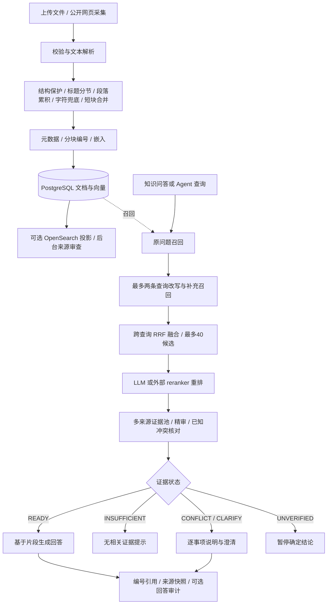

# RAG 全流程

RAG 在本项目中是“用个人资料为回答提供证据”的一条受控链路，连接文件摄入、持久索引、混合召回、模型精审、来源治理和回答引用。Java 与 Go 共享以下设计，具体事务与运行差异见[双版本说明](backend-parity.md)。

## 流程图

## 四类入口与两种检索层

| 入口 | 行为 | 是否调用聊天模型 |
| --- | --- | --- |
| `POST /api/v1/knowledge/search` | 基础混合检索，返回命中片段 | 不调用聊天模型；向量通道仍调用嵌入模型 |
| `POST /api/v1/knowledge/ask` | 完整 RAG + 非流式资料问答 | 开启 RAG 时有改写/重排/精审；可作答时再调用回答模型 |
| 对话 `useKnowledge=true` | 结合最近对话理解追问，再接 RAG，引用随聊天保存 | 有会话检索路由；普通任务/聊天可跳过资料检索 |
| Agent `searchKnowledge` | 模型按需调用共享知识检索接口 | RAG 开启时可触发多阶段模型处理，不是纯数据库查询 |

“基础检索”和“多阶段 RAG”不是同一个入口。前者按文档去重；后者保留片段候选，完成多来源精审后再选择证据。不能用基础检索的 R@5 代替答案质量。

`RAG_ENABLED=false` 时，共享知识接口退回基础检索，不执行多阶段改写/重排/精审；知识问答有命中时仍会调用回答模型。`OPENSEARCH_ENABLED` 和 `AI_KNOWLEDGE_HYBRID_ENABLED` 也不是同一个开关，详见[召回路径](rag-retrieval.md)。

## 摄入与数据

支持 UTF-8 Markdown/文本、PDF 文本层、DOCX 段落/表格及由视觉模型转录的图片。默认文件上限 5 MiB，解析后少于 350 字符会拒收。结构切块目标 1200 字符，默认不重叠。代码、表格、列表、引用和块级公式整块保护，行内代码避开断点；超长受保护结构允许超过目标长度，仍需满足嵌入模型输入限制。

每个片段有 `document_id/document_title/filename/chunk_index`，`chunk_index` 从 0 开始；用户看到的引用编号 `[1]` 从 1 开始，两者不要混淆。PostgreSQL 维护原文片段和向量；OpenSearch 的命中须回到数据库取当前片段与元数据。

推荐通过异步 `knowledge/jobs` 摄入：持久保存任务，Worker 在事务外做解析与嵌入，在提交前核验租约；失败、进度与有限重试可见。原始上传文件与聊天附件的保留语义不同，不能把分块导出当作原文件备份。细节见[摄入与切块](rag-ingestion.md)。

## 检索如何变成证据

原问题先召回，再生成最多两个检索改写；各查询的候选按分块标识合并。每查询最多请求 40 个候选，跨查询融合后最多保留 40 个。之后使用 LLM 或配置的 cross-encoder 重排，精审池优先覆盖不同文档、每文档最多两个片段，常规池上限 16；已知冲突来源可能补入。

精审需要完整、合法的结构化输出，逐条判断支持/部分支持/无关，比较对象、时间、适用范围。不同版本并不自动等于冲突，相似度高也不能决定哪个来源真实。状态与降级路径见[检索与证据](rag-retrieval.md)。

## 模型调用与延迟

普通 `READY` 的完整资料问答通常包含 **改写、重排、证据精审、最终回答**四次聊天调用；以下情况会改变次数：空库/空候选提前结束、外部 reranker 替代 LLM 重排、会话路由、恢复的冲突范围复核、保护性答案、可选引用审计、摘要和长期记忆等。

因此“用户发送一次消息”不等于“只调用一次模型”。`RAG_BUDGET_MS=20000` 是检索管线的共享预算，不是包含排队、最终生成及所有后台工作的端到端 SLA。精审默认单阶段上限 12000ms，其余阶段受剩余时间约束。

## 质量与边界

- `READY` 表示当前流程允许生成资料回答，不是事实已经被独立认证。
- 无证据时不调用最终回答模型；前面的查询改写/精审可能已经发生。
- 改写/重排失败会保留回退结果与 warning；精审失败标记 `UNVERIFIED`，不把候选直接包装成确定答案。
- 冲突与澄清可生成逐事项说明；有来源并不意味可以对所有事项确定作答。
- `[n]` 只绑定服务端提供的来源。普通回答没有写合法编号时，当前问答实现会返回全部候选作为来源回退；这不等于每条都被模型明确引用。
- 可选引用审计是附加检查，不是自动修复或事实保证。
- Go 与 Java 在无关证据澄清分类、旧同步摄入等处存在已记录差异；不要宣称逐字或全场景等价。

## 阅读与源码

- [解析、切块、嵌入、异步任务](rag-ingestion.md)
- [召回、融合、重排、证据、引用、缓存](rag-retrieval.md)
- [参数与模型配置](configuration.md)
- [真实评测与历史结论](evaluation.md)
- Java：[KnowledgeRetrievalService](../backend/src/main/java/com/personalos/knowledge/service/KnowledgeRetrievalService.java)、[RagRetrievalPipeline](../backend/src/main/java/com/personalos/knowledge/rag/RagRetrievalPipeline.java)、[KnowledgeQaService](../backend/src/main/java/com/personalos/knowledge/service/KnowledgeQaService.java)。
- Go：[retrieval.go](../backend-go/internal/business/knowledge/retrieval.go)、[rag.go](../backend-go/internal/business/knowledge/rag.go)、[qa.go](../backend-go/internal/business/knowledge/qa.go)。
